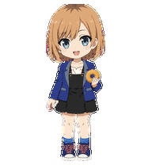

# codex-pets

我的 Codex 宠物收藏。每只宠物都有独立目录、预览和可直接解压安装的 ZIP 包，后续创作会继续添加到这里。

## 宠物一览

| 洄 · Hui | 宫森葵·喵森 | 奔跑吧·喵森 |
| :---: | :---: | :---: |
|  |  |  |
| 白色线条与透明留白构成的安静游鱼 | 蓝色外套、甜甜圈与认真元气的神情 | 珊瑚橘外套、怀抱原画信封的小跑 |
| [查看详情](pets/hui-line-fish/) · [下载 ZIP](downloads/hui-line-fish.zip) | [查看详情](pets/miyamori-aoi/) · [下载 ZIP](downloads/miyamori-aoi.zip) | [查看详情](pets/run-myaamori/) · [下载 ZIP](downloads/run-myaamori.zip) |

## 安装

1. 下载上表中对应的 ZIP，解压得到以宠物 ID 命名的文件夹。
2. 将文件夹放到 Codex 的宠物目录中；已有同名文件夹时先备份。
3. 打开应用的「设置 → 宠物」，刷新列表并选择宠物。

默认宠物目录：

- macOS / Linux：`~/.codex/pets/`
- Windows：`%USERPROFILE%\.codex\pets\`
- 自定义环境：`$CODEX_HOME/pets/`

例如安装「奔跑吧·喵森」后：

```text
~/.codex/pets/
└── run-myaamori/
    ├── pet.json
    └── spritesheet.webp
```

两个文件需要保持同级，图集文件名与配置中的 `spritesheetPath` 一致。

## 仓库结构

```text
pets/
├── hui-line-fish/       # 洄
├── miyamori-aoi/        # 宫森葵·喵森
└── run-myaamori/        # 奔跑吧·喵森
downloads/              # 每只宠物的安装包
catalog.json            # 宠物目录、预览、下载位置与图集校验值
```

每只宠物采用 Codex v2 格式：透明 WebP 图集 1536 × 2288 像素，8 列 × 11 行，单帧 192 × 208 像素；包含 9 组标准状态动作与 16 个视线方向。

「宫森葵·喵森」与「奔跑吧·喵森」以动漫《白箱》的宫森葵为角色参考，采用 AI 辅助绘制，动作经过独立视觉验收。各宠物的具体设定见对应目录的说明。

## 添加新宠物

在 `pets/<pet-id>/` 下添加 `pet.json`、`spritesheet.webp`、预览和说明，再更新 `catalog.json`、首页展示及对应 ZIP 安装包即可。

本仓库由 `hui-line-fish` 更名而来。根目录原有的 `pet.json`、`spritesheet.webp` 与 `preview.png` 继续保留，方便原来的「洄」下载路径使用。
