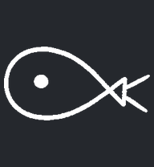

# 洄 · Hui

一条由白色线条与留白构成的游鱼。冷峻、安静，保留一点手绘的松弛感。

A minimalist white-line fish pet for Codex, with a transparent body and background.



> 深灰色仅为预览背景；实际宠物背景和鱼身内部均为透明。

## 安装

下载本仓库，将 `pet.json` 和 `spritesheet.webp` 放在同一个 `hui-line-fish` 文件夹内，再将该文件夹放入 Codex 的 `pets` 目录：

- Windows 默认路径：`%USERPROFILE%\.codex\pets\hui-line-fish\`
- macOS / Linux 默认路径：`~/.codex/pets/hui-line-fish/`
- 如果自定义了 `CODEX_HOME`，使用其下的 `pets/hui-line-fish/`。

最终目录结构：

```text
pets/
└── hui-line-fish/
    ├── pet.json
    └── spritesheet.webp
```

在支持自定义宠物的 Codex 版本中选择「洄」。若更新图片后仍显示旧版，可尝试切换到其他宠物再切回；必要时重启应用。

## 图集

- Codex sprite version 2
- 1536 × 2288，8 列 × 11 行
- 单帧 192 × 208
- 9 组标准动作与 16 个朝向
- 白色线条，RGBA 透明背景，WebP 无损编码

白色版仅改变颜色，保留原版每个像素的透明度、帧布局和动作几何。

## 制作

根据作者个人主页中的线条鱼意象制作，使用 AI 辅助生成动作，并进行图集组装和校验。
