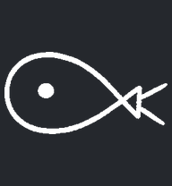
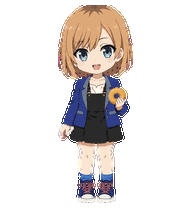

# Codex Pets

面向 Codex 的自定义桌面宠物合集，包含 Codex v2 无损透明 WebP 动作图集、动图预览与可直接解压安装的 ZIP 包。

[English](README.md) · 简体中文

## 宠物一览

| 洄（`hui-line-fish`） | 上班中·喵森（`miyamori-aoi`） | 奔跑吧·喵森（`run-myaamori`） |
| :---: | :---: | :---: |
|  |  |  |
| 白色线条与透明留白构成的安静游鱼 | 蓝色工作外套、手拿甜甜圈的元气桌伴 | 珊瑚橘外套、怀抱原画信封赶稿小跑 |
| [详情](pets/hui-line-fish/) · [下载 ZIP](downloads/hui-line-fish.zip) | [详情](pets/miyamori-aoi/) · [下载 ZIP](downloads/miyamori-aoi.zip) | [详情](pets/run-myaamori/) · [下载 ZIP](downloads/run-myaamori.zip) |

## 安装方法

1. 从上表下载对应宠物的 ZIP 包，解压得到以 `<pet-id>` 命名的文件夹。
2. 将该文件夹放入 Codex 宠物目录（macOS / Linux 为 `~/.codex/pets/`，Windows 为 `%USERPROFILE%\.codex\pets\`，自定义环境为 `$CODEX_HOME/pets/`）。
3. 打开 Codex「设置 → 宠物」，刷新列表并选择对应宠物。

`pet.json` 与 `spritesheet.webp` 需保持同级，确保配置中的 `spritesheetPath` 正常解析：

```text
~/.codex/pets/
└── run-myaamori/
    ├── pet.json
    └── spritesheet.webp
```

## 图集规格与目录结构

每只宠物均采用 **Codex v2 图集格式**：`1536 × 2288` 像素无损透明 WebP（`8` 列 × `11` 行，单帧 `192 × 208` 像素），涵盖 9 组标准状态动作与 16 个视线方向。

```text
pets/<pet-id>/          单只宠物的 pet.json、spritesheet.webp、预览图与说明
downloads/<pet-id>.zip  可直接解压安装的宠物压缩包
catalog.json            宠物索引、预览路径、尺寸规格与图集 SHA-256 校验值
```

新增宠物时，在 `pets/<pet-id>/` 下放入配置、图集、预览与说明，打包至 `downloads/<pet-id>.zip` 并更新 [catalog.json](catalog.json) 即可。仓库由 `hui-line-fish` 更名而来，根目录保留的 `pet.json`、`spritesheet.webp` 与 `preview.png` 用于兼容旧版直链。

## 附注

「上班中·喵森」与「奔跑吧·喵森」以动画《白箱》（*Shirobako*）角色宫森葵为原型创作，采用 AI 辅助绘制并手工完成图集切帧与组装。
