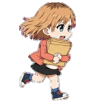

# 奔跑吧·喵森

参考《白箱》中宫森葵怀抱原画信封奔跑的画面创作。保留珊瑚橘外套、扬起的焦糖短发、三只叠放的牛皮纸信封，以及略显着急的神情。

[下载宠物安装包](../../downloads/run-myaamori.zip)

解压后，将 `run-myaamori` 文件夹放入 `~/.codex/pets/`。如果设置了 `CODEX_HOME`，则放入其中的 `pets/`。在应用的宠物设置中刷新并选择「奔跑吧·喵森」。

`pet.json` 和 `spritesheet.webp` 必须放在同一个文件夹中。宠物采用 Codex v2 图集：1536 × 2288 像素，单帧 192 × 208 像素，包含 9 组状态动作与 16 个视线方向。

参考画面仅展示上半身，黑色短裙、蓝袜与深蓝运动鞋是为完整人物所作的设计补充。左右奔跑分别绘制，保持发型与抱信封手势的辨识度。成品已完成图集、透明边缘、动作循环与独立方向验收。
